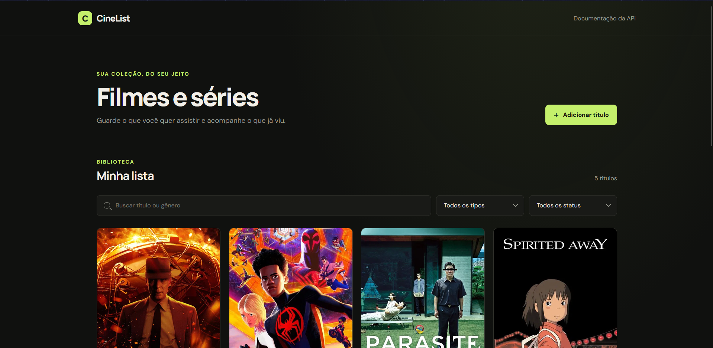
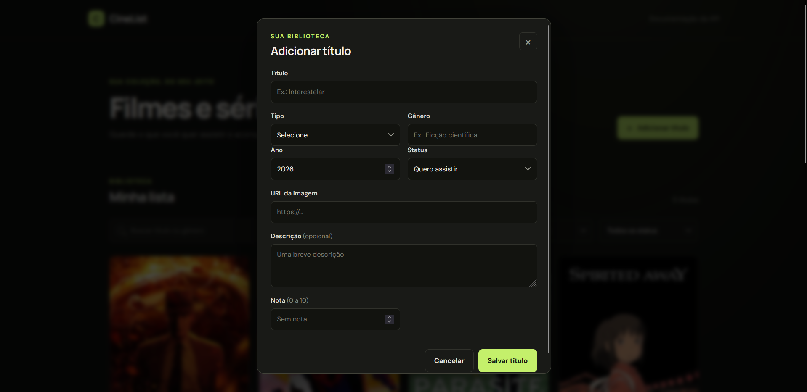

# CineList - Frontend

Interface web simples e responsiva para gerenciar filmes e séries. O frontend foi feito por IA para proporcionar uma experiência mais organizada, clara e agradável.

## Complementar

Este readme é um complementar do [Backend](../README.md).

## Pré-requisitos

- Windows e CMD.
- Python instalado e disponível pelo comando `python`.
- Acesso à internet para conectar à API publicada.
- VS Code (opcional).

## Instalar e iniciar o frontend

Não é necessário instalar dependências para executar a interface. No CMD, na pasta raiz do projeto, inicie um servidor local:

```cmd
python -m http.server 5500
```

Abra `http://localhost:5500` no navegador. A página inicial redireciona para `web/filmes.html`.

Mantenha a janela do CMD aberta enquanto usar a interface. A porta `5500` está entre as origens locais permitidas pelo CORS do backend. A origem `https://zenvexy.github.io` também está permitida para o GitHub Pages.

## Usar a interface

A tela inicial mostra os filmes e as séries cadastrados. Use a busca para encontrar títulos por nome ou gênero e os filtros para separar por tipo ou status.

O botão **Adicionar título** abre o formulário de cadastro. Cada título pode incluir imagem, ano, gênero, descrição, nota e status. Os botões **Editar** e **Excluir** em cada item permitem atualizar ou remover um título da lista.

## Screenshots

Tela da biblioteca:



Formulário para adicionar um título:



## Integração com o backend

A interface usa a API publicada em `https://cinelist-backend.vercel.app`. A lista, o cadastro, a atualização e a exclusão usam as rotas abaixo:

```text
/api/filmes/listar
/api/filmes/cadastrar
/api/filmes/atualizar/{filme_id}
/api/filmes/excluir/{filme_id}
```

As opções de tipo e status são carregadas diretamente do backend. Para consultar todas as rotas, acesse a [documentação da API](https://cinelist-backend.vercel.app/docs).

## License

Este projeto é licenciado sob a [Apache License 2.0](../LICENSE).
